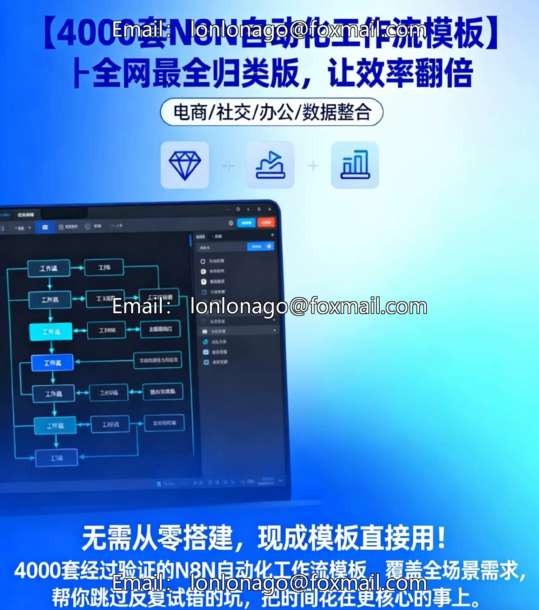
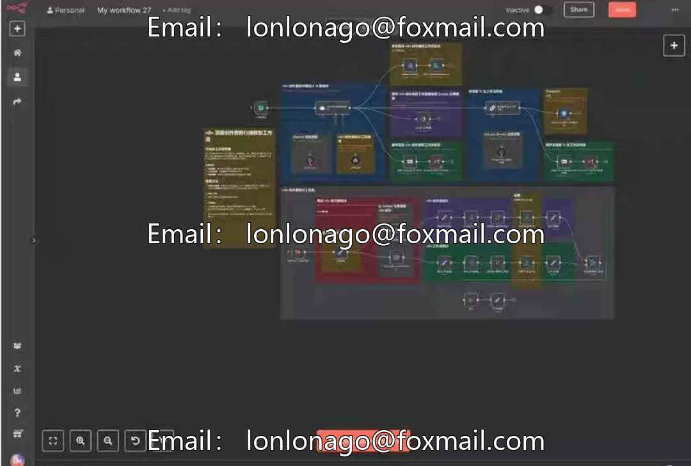

# n8n automation workflows 4000+ sets (sorted and categorized, the most comprehensive available online).

## Body

n8n automation workflows 4000+ sets (sorted and categorized, the most comprehensive available online).

n8n automation workflows 4000+ sets (sorted and categorized, the most comprehensive available online).

4000 sets of templates include Chinese labels and functional introductions, supporting quick browsing and retrieval, greatly improving work efficiency.
Practical templates · One-click import · Covers all scenarios

Included Content
- 4000+ sets of n8n template JSON files
- n8n installation and template import tutorials
- Quick browse and search for templates (Excel tables and HTML locally opened)

Service Content
Notes (Please read before purchasing)
This product is digital and cannot be returned once sold. Please make a purchase based on the description and illustrations provided.

The product does not include Q&A services. If you have any questions about its usage, please refer to the documentation or search for relevant information on your own.

The template does not include platform account or API key. If you need to use the related services, please provide your own API credentials.

Immediate dispatch, clear file packaging structure, well-defined classification, long-term benefits for one-time purchase.

In automation, there's no need to start from scratch.

Use a verified solution to save countless hours and energy.
Customizable according to industry needs, for intelligent agents.

## Images

## Payment

Here is a pay link on Stripe ( https://buy.stripe.com/3cs8yP7sY87d0vu9AB ). Please contact me lonlonago@foxmail.com after funding $89, and I will send you a complete data files , thank you!

